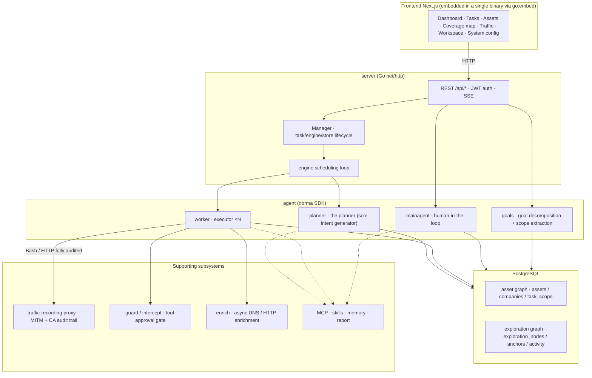
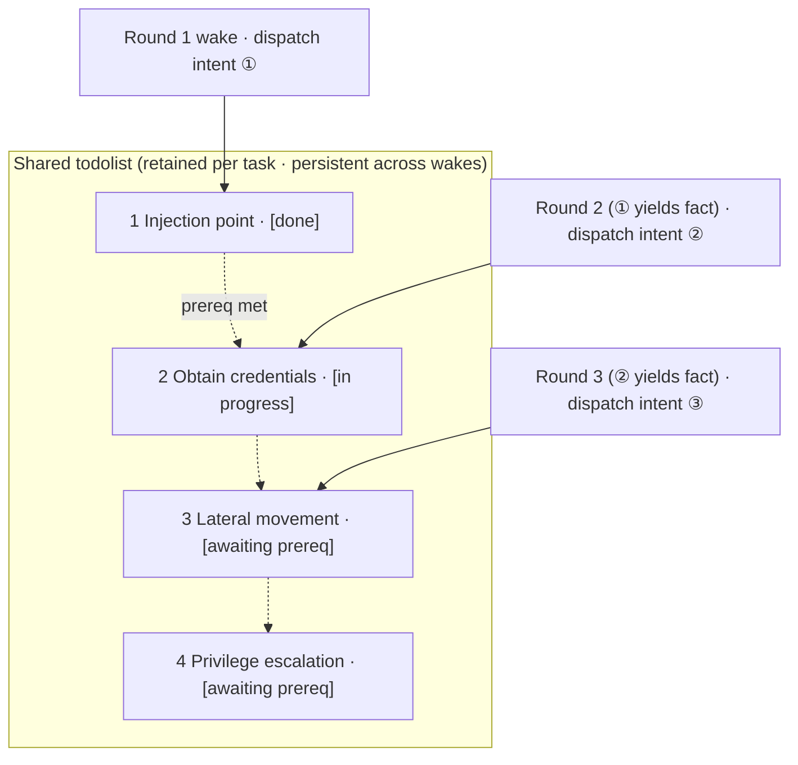

<div align="center">

# ARTEX

AI-driven autonomous penetration testing system (Go backend + Next.js frontend)


🌐 **Live demo**: [https://artex-demo.vercel.app/](https://artex-demo.vercel.app/)

</div>

---

## Screenshots

> For the full interactive experience, see the [live demo](https://artex-demo.vercel.app/).

| Dashboard (Overview / Token usage / Activity feed) | Task list |
| :---: | :---: |
|  |  |

| Task · Execution process (Sessions / Tool calls) | Exploration lineage |
| :---: | :---: |
|  |  |

| Findings | Assets |
| :---: | :---: |
|  |  |

| Asset coverage map (force-directed layout · tested nodes highlighted · collapsible/expandable nodes) |
| :---: |
|  |

| Traffic recording | Human-in-the-loop conversation |
| :---: | :---: |
|  |  |

| Agent management | LLM configuration |
| :---: | :---: |
|  |  |

| Interception approvals | Backend logs |
| :---: | :---: |
|  |  |


---

## Approval record details

The global "Approval records" view, the per-task "Interception approvals" view, and the approval cards inside conversations can all be expanded to show details. The presentation structure is modeled on
[AegisHook's approval-detail component](https://github.com/RuoJi6/AegisHook/blob/main/web/src/components/CallDetail.vue), reusing ARTEX's own components and theme:


## Asset sync (ScopeSentry)

You can sync asset data directly from [ScopeSentry](https://github.com/Autumn-27/ScopeSentry), avoiding duplicate collection:

- On the "**Asset Sync**" page, enter the ScopeSentry address and API key to connect the data source;
- Choose the targets and asset types to sync by **project** or by **task** (domains / subdomains / IPs / ports / sites / endpoints …);
- Import in one click and merge everything by company asset scope, feeding directly into ARTEX's asset graph for agents to explore.

---

## Installation

> Requires a **PostgreSQL** database; exploration requires an **LLM** (`ANTHROPIC_API_KEY` or `OPENAI_API_KEY`, which can also be set in the UI).

### Option 1: One-click install script (recommended)

```bash
git clone https://github.com/Hinln/ARTEX.git
cd ARTEX
./install.sh
```

The script will: detect / auto-install Docker → let you choose **① All-Docker** or **② Build and run locally**:

- **① All-Docker**: enter a Postgres password (press Enter for a random one) → writes `.env` automatically → `docker compose up -d`.
- **② Run locally**: pick a database (connect to an existing one / spin one up with Docker) → generate `config.json` → `go` compiles a single binary with the frontend embedded → start.

Once installed, open **http://localhost:8787** (on first visit, go to `/setup` to set the admin password).

### Option 2: Docker Compose (manual)

```bash
git clone https://github.com/Hinln/ARTEX.git
cd ARTEX
cp .env.example .env          # fill in POSTGRES_PASSWORD, optionally ANTHROPIC_API_KEY
docker compose up -d          # pulls the autumn27/artex image + postgres
# → http://localhost:8787
```

The image already bundles common tools (ripgrep/curl/vim/npm/nmap…); `./skills` and `./data` are persisted via bind mounts.

Remote MCP can be configured in system settings as either `http` (Streamable HTTP) or `sse` (legacy SSE).
A legacy SSE service typically uses `GET /sse` to open the event stream, then receives JSON-RPC
requests via the service-returned `/message?sessionId=...`; when configuring, set the URL to `/sse` and set the
header to `Authorization=Bearer <token>`.

### Option 3: Download a prebuilt binary (Releases)

Go to [Releases](https://github.com/Hinln/ARTEX/releases), download the zip for your platform, and unpack to get `artex` + `start.sh` (`start.bat` on Windows) + `skills/` + `config.example.json`:

```bash
cp config.example.json config.json   # fill in the database connection
./start.sh                           # → http://localhost:8787
```

> Start it with `start.sh` / `start.bat` rather than running `./artex` directly. It is a supervisor script: after the program exits, it decides whether to relaunch based on the exit code, and **the in-page [one-click update](#option-1-in-page-one-click-update-recommended) relies on it to swap the binary**. If you run `./artex` directly, nothing relaunches it after an update.
> Run in the background: `nohup ./start.sh >artex.log 2>&1 &`.

### Option 4: Build a single binary from source

```bash
# 1) Static export of the frontend
cd web && npm ci && npm run build:static && cd ..
# 2) Copy it into the embed directory
cp -r web/out server/webui/dist
# 3) Build (the frontend is only embedded with -tags embedui)
CGO_ENABLED=0 go build -tags embedui -o artex ./cmd/artex
./start.sh
```

### Option 5: Build cross-platform release archives

`build.sh` first builds and embeds the frontend, then uses the Go linker to strip debug info and compresses the release files into zips. By default, release mode produces zips for Linux amd64/arm64, macOS amd64/arm64, and Windows amd64:

```bash
./build.sh --release
# Output: dist/artex-0.3.3-*.zip
```

UPX self-extracting binaries may be incompatible with some Linux kernels, virtualization environments, or security policies, so they are off by default. You can customize targets with `ARTEX_TARGETS`; when you have confirmed the target runtime is compatible, you can pass `--upx` explicitly to shrink the binary further:

```bash
ARTEX_TARGETS=linux/amd64,windows/amd64 ./build.sh --release
./build.sh --target linux/amd64 --upx
```

---

## Upgrading

> An upgrade only swaps the program; your data is untouched: the Postgres data volume `pgdata`, `./data` (jwt.key / SQLite, etc.), and `./skills` are all preserved. **Database migrations do not need to be run by hand** — on every startup `artex` idempotently re-runs `schema.sql` (including `ADD COLUMN` / `CREATE INDEX IF NOT EXISTS`), i.e. "restart = migrate". Even so, we still recommend backing up `./data` and the database before upgrading.

### This repository's private release update source

The in-page one-click update always checks and downloads versions from [Hinln/ARTEX Releases](https://github.com/Hinln/ARTEX/releases). Cloning or updating source via Git also uses `Hinln/ARTEX`; the original project's Go module path stays unchanged.

This is a private repository. Set `ARTEX_UPDATE_GITHUB_TOKEN` for the backend process that runs ARTEX; the token only needs **Contents: read** permission on this repository. The backend uses the token to query releases and download attachments; it is never sent to the browser, and must not be committed to Git.

```bash
# First set ARTEX_UPDATE_GITHUB_TOKEN securely in the current shell or service environment
./start.sh
```

When started directly and locally, `start.sh` does not read `.env` automatically; you must export the variable into the process environment. For a Docker Compose deployment, you can put the variable in a `.env` file that is not tracked by Git and rebuild the artex container; the image must include the update code from this branch — an older image will not switch its update source as a result.

Before the in-page update can offer an installable version, you must publish a non-draft, non-prerelease official release in this repository, attaching `artex-<version>-<os>-<arch>.zip` and `SHA256SUMS`. If the repository contains only source, online upgrades are not yet available. The existing release workflow generates these attachments for the current repository whenever a `v*` tag is pushed.

### Option 1: In-page one-click update (recommended)

On the **System Configuration** page (sidebar "System Configuration" → `/system/settings`), the **Version & Updates** card lets you check for and install new versions directly, without logging into the server.

After clicking "Update": it downloads the release package for your platform → compares against the release's `SHA256SUMS` → runs a `-h` smoke test on the new binary → stages it as `artex.new` → the program exits, and `start.sh` / `start.bat` relaunches it and completes the swap. The page automatically waits until the new version is live, then refreshes.

- **A failure never leaves a broken program behind**: if verification or the smoke test fails, the staged file is discarded and the current version keeps running; if a newly swapped-in version fails to start 3 times in a row, it automatically rolls back to `artex.old` (the failed binary is kept as `artex.failed` for investigation).
- **Reversible at any time**: the previous version is kept as `artex.old`, and the card has a "Roll back to previous version" button. Note that the database schema is not rolled back.
- **An update interrupts any running tasks** — updating means restarting, so do it when idle.
- **Development builds are not offered updates**: it is disabled when the version is `dev` or `git describe` has a suffix, to avoid overwriting a locally debugged binary with an official release.
- **Under Docker, only the program is swapped, not the image**: toolchains baked into the image (playwright / nmap, etc.) are not upgraded along with it, and after `docker compose up -d` rebuilds the container it will revert to the versions shipped in the image. To upgrade the image too, still use `docker compose pull artex && docker compose up -d artex`.
- If reaching GitHub requires a proxy, just configure the **global proxy** on the same page and the update path will go through it. Updates are only downloaded from GitHub domains, over enforced HTTPS.

### Option 2: One-click update script

```bash
cd ARTEX
./update.sh
```

The script first optionally runs `git pull` to fetch the latest code, then lets you choose **① Docker update** or **② local build update** (matching `install.sh`):

- **① Docker**: you can specify the target image tag (press Enter to reuse `ARTEX_TAG` from `.env`, defaulting to `latest`) → `docker compose pull` → `docker compose up -d` (restarting with the new image migrates automatically).
- **② Local**: rebuild the frontend static output → recompile `./artex` (restart the process afterwards for it to take effect).

### Option 3: Docker Compose (manual)

```bash
cd ARTEX
git pull                       # update compose / scripts (optional)
# Pin a version: set ARTEX_TAG=v0.2.0 in .env; otherwise latest is used
docker compose pull artex
docker compose up -d artex     # restart with the new image → schema migrates automatically
docker image prune -f          # clean up old images (optional)
```

### Option 4: Prebuilt binary (Releases)

Go to [Releases](https://github.com/Hinln/ARTEX/releases), download the new version's zip, stop the old process, overwrite `artex` and `skills/` (keeping your `config.json` and `data/`), and restart:

```bash
cp -r <unpacked dir>/skills ./ && cp <unpacked dir>/artex ./
./start.sh
```

### Option 5: Build from source

```bash
git pull
cd web && npm ci && npm run build:static && cd ..
cp -r web/out server/webui/dist
CGO_ENABLED=0 go build -tags embedui -o artex ./cmd/artex
# Restart ./start.sh
```

---

## Configuration

**Database** (`config.json`, or override with the `ARTEX_PG_DSN` environment variable):

```json
{
  "database": {
    "host": "127.0.0.1", "port": 5432,
    "user": "artex", "password": "yourpass",
    "dbname": "artex", "sslmode": "disable"
  }
}
```

**LLM**: `export ANTHROPIC_API_KEY=sk-...` (or `OPENAI_API_KEY`); you can also set it on the UI's "LLM Configuration" page.
Optional: `ARTEX_LLM_PROVIDER` / `ARTEX_LLM_MODEL` / `ARTEX_LLM_BASE_URL` / `ARTEX_LLM_PROXY`.

**Concurrency**: the number of work agents per task is configured in "System Settings" (default 3).

**Common arguments**: `./start.sh -addr :8787 -proxy :8788` (`-addr` for the frontend + API, `-proxy` for the traffic-recording proxy). The startup script passes the arguments through to `artex` verbatim.

### Deploying behind a reverse proxy (HTTPS / expose only 443)

The frontend and the API/SSE are served by the same backend port (default `:8787`), and the real-time activity feed uses a **same-origin** address by default, so **there is no need to configure `NEXT_PUBLIC_SSE_BASE`** — expose only 443 publicly and keep 8787 on the internal network.

SSE is a long-lived connection with continuous push, so the reverse proxy **must disable buffering**; otherwise the browser connects but receives no events (the activity feed just spins forever). Nginx example:

```nginx
server {
    listen 443 ssl;
    server_name your.domain.com;
    # ssl_certificate / ssl_certificate_key ...

    location / {
        proxy_pass http://127.0.0.1:8787;
        proxy_set_header Host $host;
        proxy_set_header X-Forwarded-Proto $scheme;

        # Critical for SSE: disable buffering, long timeout, HTTP/1.1
        proxy_buffering off;
        proxy_cache off;
        proxy_read_timeout 3600s;
        proxy_http_version 1.1;
        proxy_set_header Connection "";
    }
}
```

> Only set `NEXT_PUBLIC_SSE_BASE` **at build time** if SSE needs to use a different origin from the page (e.g. a separate subdomain). (This variable is baked into the static bundle during `next build`; setting it at container runtime has no effect.)

---


## Development

### Manual finding re-testing

The "Re-test" tab in a task's detail view lets you page through this task's findings, review the history of conclusions and evidence, and manually trigger a re-test. Once started, it keeps the current tab, shows a spinner and "Re-testing"; after a fix is confirmed, the finding's status is updated accordingly.

Click "Re-test" in the action area of each row in the findings list, or click "Start re-test" in the "Finding re-test" area of a finding's detail view, then fill in an optional fixed version, test conditions, or constraints. The system creates a standalone re-test agent session, and once started it keeps the current page. The flat view, the task-grouped view, and the asset view all support this entry point; while a re-test is running it shows a spinner and "Re-testing" — click through to the corresponding session when you want to look, and once it finishes it returns to "Re-test". A re-test does not require restarting the original scan task; conclusions are categorized as "Still reproducible", "Fixed", or "Unable to confirm", and each conclusion, its evidence, and the session link are saved in the finding's detail view.

On its first startup, the new backend seeds an editable "Finding re-test" (`retester`) agent, whose prompt, LLM, run budget, and tools can be configured in Agent management. By default it uses the LLM bound to it, falling back to the globally active configuration if none is bound. When a re-test session completes successfully with a conclusion of "Fixed", the system automatically changes the finding's disposition status to "Fixed"; while running, or on failure, stop, or any other conclusion, the original status is kept. The original evidence and report are always preserved. You can also manually choose "Fixed" from the status dropdown. While a finding is being re-tested, the existing session is reused; after a stop, failure, or service restart, it can be re-triggered.

The history in this version is viewed through finding details and sessions; it is not yet included in finding report exports or task archive bundles, nor automatically linked to traffic captures. Demo mode only generates clearly labeled simulated records and never contacts real targets.

### Running and testing locally

```bash
./dev.sh    # backend (:8787) + traffic proxy (:8788) + frontend next dev (:5173) → http://localhost:5173
```

- Backend: `go run ./cmd/artex` (without `-tags embedui` the frontend is not embedded)
- Frontend: `cd web && npm run dev` (`/api` is reverse-proxied to the backend, with hot reload)
- Tests: `go test ./...`
- Mock preview (no backend): `cd web && NEXT_PUBLIC_MOCK=1 npm run dev`

---

## System architecture

ARTEX is an **LLM multi-agent–driven autonomous penetration system**: a single Go backend (with the Next.js frontend embedded) + PostgreSQL, where agent capabilities are provided by the [`norma`](https://github.com/Autumn-27/norma) SDK (`agentcore` / `tool` / `permission` / `harness` / `memory` / `transcript`). At its core is a **dual-graph architecture**, together with the two autonomy mechanisms built around it: **process-level information exchange between workers** and the **planner's multi-round shared todolist that stabilizes attack chains**.

### Overall layering



| Layer | Responsibility |
| --- | --- |
| **Frontend** | Next.js static export, embedded into the single binary via `go:embed`; visualizes tasks/assets/exploration lineage/coverage map and the human-in-the-loop conversation |
| **server** | `net/http` routing + JWT auth + SSE; the `Manager` owns the lifecycle of tasks, engines, and DB stores |
| **engine** | one `plannerLoop` + N worker goroutines per task; intent claiming, timeout/pause/drain |
| **agent** | goals / planner / worker / mainagent, with `ToolSet` exposing the dual graph as LLM tools |
| **db** | Postgres persistence of the dual graph (pgx); the schema is created idempotently on every startup via `go:embed` |
| **Supporting** | recording MITM proxy, approval gate, async enrichment, MCP/skills/memory/report |

### Dual-graph architecture: exploration graph + asset graph

The system splits "**what the target is**" from "**how thoroughly it has been tested**" into two graphs that are independent of each other yet connected via anchors:

- **Asset Graph (globally shared)**: a single source-of-truth asset store shared across tasks. Its nodes are `root_domain / subdomain / ip / service / app / endpoint`, each belonging to a company; the domain→subdomain→service→endpoint parent-child relationships and dedup keys are all computed by the program — agents only submit raw information.
- **Exploration Graph (per-task, independent)**: the "thinking and progress" process of a single task. Its nodes are `goal / intent / fact / finding / hint`, linked into a **lineage chain** via edges like `spawns / derived_from / yields / proves`, answering "which direction derived from which facts, and what it produced".
- **The two graphs are joined by anchors**: `exploration_anchors(node_id, asset_id)` anchors intents/facts/findings to concrete assets — so you can both see from an "exploration direction" which assets it targets, and from "a given asset" look back at which intents tested it in this task and what facts they yielded. This also powers **asset test coverage** and the **asset coverage map** (in-scope assets + tested nodes highlighted).


> Division of labor: the **planner** reads the exploration graph's state, judges goals, and dispatches **intents** into the frontier only when there is an uncovered new direction; a **worker** claims **one intent**, executes it with real tools, writes new assets/facts/findings back to both graphs, and then stops. The asset graph is shared fact; the exploration graph is each task's progress chain.

### Engine and intent lifecycle (the closed loop of one exploration)

The engine is an **event-driven** closed loop: any change to the graph wakes the planner, the planner dispatches intents, a worker claims and executes an intent and writes back, and the write-back triggers the next round — until the goal is proven (`prove_goal`).


### Process-level information exchange between workers

In a deep exploration, many valuable observations (some error message, a snippet of a response, a hidden parameter) show up in one worker's **execution process** without necessarily being written up as a formal fact. To avoid duplicated effort and let workers along the chain stand on each other's shoulders, workers can **search across other workers' processes**:

- `search_all_worker_traces(q)`: keyword-search **the execution processes of other work in this task** (automatically excluding the steps of your own intent); hits carry an `intent_id`;
- `list_worker_traces` / `get_worker_trace(intent_id, step_ids=[…])`: first see which work has run, then pull the full content of a few specific steps of a given work for a detailed exchange.

This way, even when no corresponding fact yet exists in the exploration graph, later workers can still reuse others' in-process observations — **information flows between workers at the granularity of the "execution process"**, while the boundaries stay fixed (each worker still only works on the one intent it claimed).


### The planner's multi-round shared todolist → stable attack chains

A real attack chain is often a **multi-step sequence with front-to-back dependencies** (e.g. find an injection point → obtain credentials → move laterally → escalate privileges); dispatching all of these in parallel at once only creates chaos. The planner therefore holds a **planning todolist that is retained per task and shared across wakes**:

- The planner is event-driven — any change to the graph wakes it, but **each wake is a fresh session**; the shared todolist lets it **record a serial exploitation chain once** and then **dispatch intents step by step across later rounds by dependency**, rather than expanding the whole chain up front in a single round;
- Each round, it only dispatches an intent for the next step whose "prerequisite steps are done and whose required fact already exists", and updates the list as progress is made (marking steps complete once a fact satisfies them).



So the attack chain still **advances stably, without duplication and without reordering** in an "event-driven + stateless session" environment — this is the key to ARTEX being able to autonomously walk through a multi-step exploitation chain.

---

## Community group

Scan the QR code to follow the WeChat Official Account **SecSentry**, then DM the account from its backend to join the group.

<div align="center">


</div>

---
## References

https://github.com/oritera/Cairn


## License and disclaimer

### Open-source license

This project is licensed under the **GNU Affero General Public License v3.0 (AGPL-3.0)**; the full terms are in the [LICENSE](LICENSE) file at the repository root.

This means anyone is free to use, modify, and distribute this project, but **derivative works must also be open-sourced under AGPL-3.0**; in particular, **if you modify this project and provide it to users over a network (e.g. deployed as an online service), you must also make the corresponding complete source code available to those users**.

> ⚠️ **Important**: The open-source license itself does not restrict how the software is used. The "usage restrictions" and "disclaimer" below are additional terms and a solemn declaration from the author to users — please observe them carefully.

**ARTEX is for personal study, code research, and local technical validation only. It must not be used to launch actual tests against any online system or website.**

### Permitted scope of use

- May only be used to **read, study, and research this project's source code**, and to validate technical principles in a **locally isolated environment**;
- Suitable for non-offensive purposes such as personal study, academic research, and code review.

### Prohibited

- **Strictly prohibited** to use this tool to scan, probe, exploit, or attack any website, online service, or networked system (regardless of authorization, and regardless of whether the asset is your own);
- Strictly prohibited to use this tool for any actual penetration testing, red/blue exercises, or production environments;
- Strictly prohibited to use this tool for illegal intrusion, data theft, extortion, denial of service, or any destructive or criminal activity;
- Strictly prohibited to use this tool to engage in conduct that violates the laws and regulations of your country/region.

### Compliance responsibility

Users must comply on their own with all laws and regulations of their country/region regarding cybersecurity, data protection, and computer crime (in mainland China, including but not limited to the Cybersecurity Law, the Data Security Law, the Personal Information Protection Law, and related judicial interpretations). **All legal liability and consequences arising from the use of this tool are borne solely by the user.**

### Disclaimer

This project is provided "AS IS", without warranty of any kind, express or implied. The author and contributors are not liable for any direct or indirect loss, data loss, system damage, or legal dispute arising from use of this tool (whether used appropriately or not). **By downloading, installing, or using this project, you acknowledge that you have read, understood, and agreed to all of the above terms.**
