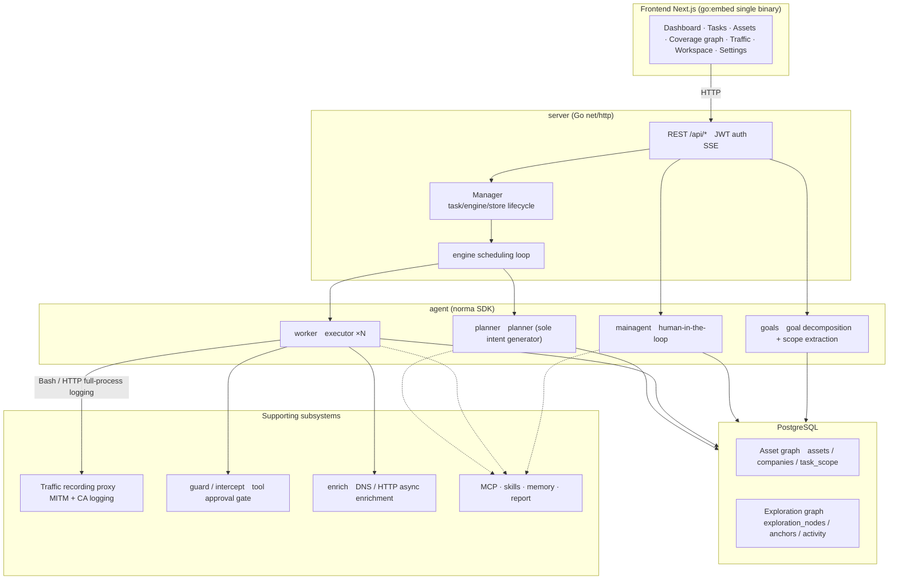
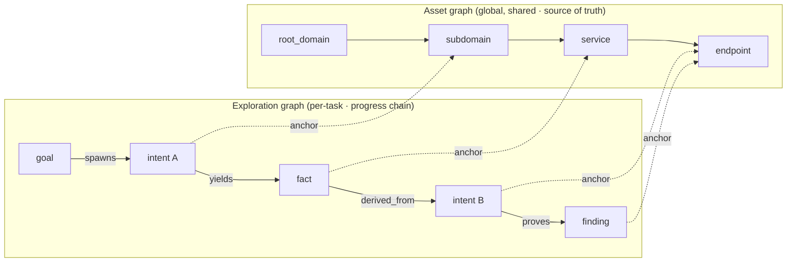
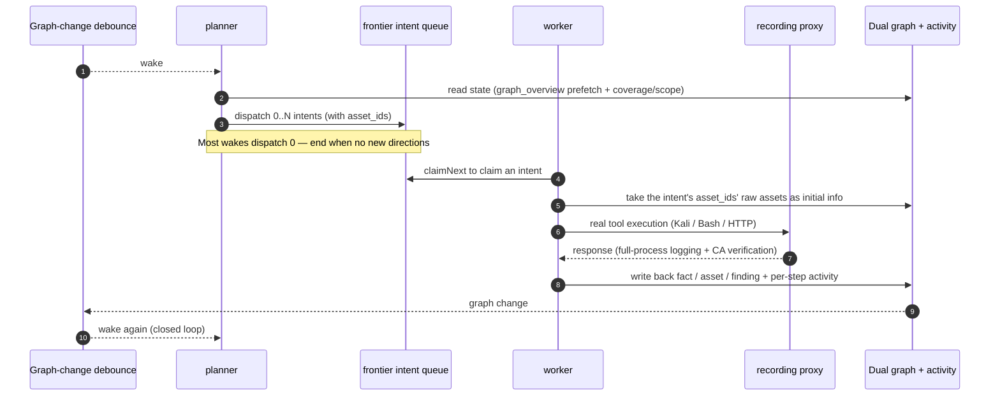
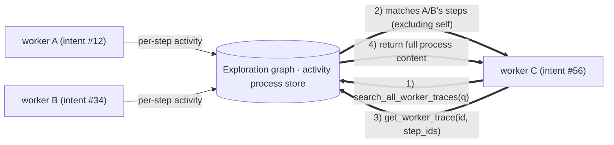
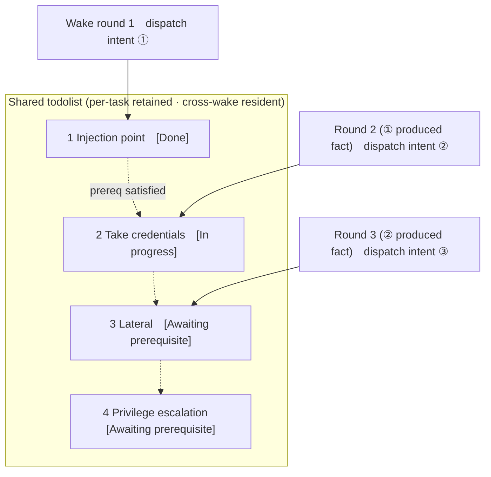

<div align="center">

# ARTEX

AI-Driven Autonomous Penetration Testing System (Go backend + Next.js frontend)


🌐 **Live Demo**: [https://artex-demo.vercel.app/](https://artex-demo.vercel.app/)

</div>

---

## Screenshots

> See the full interactive demo at [Live Demo](https://artex-demo.vercel.app/).

| Dashboard (overview / token usage / activity stream) | Tasks |
| :---: | :---: |
|  |  |

| Task · execution (session / tool calls) | Exploration graph |
| :---: | :---: |
|  |  |

| Findings | Assets |
| :---: | :---: |
|  |  |

| Asset coverage map (force-directed layout · tested highlighted · node collapse/expand) |
| :---: |
|  |

| Traffic recording | Human-in-the-loop chat |
| :---: | :---: |
|  |  |

| Agent management | LLM configuration |
| :---: | :---: |
|  |  |

| Intercept & approval | Backend logs |
| :---: | :---: |
|  |  |


---

## Approval detail view

The global "Approval history", in-task "Intercept approval", and chat approval cards all
support expanding to view details. The display structure follows
[AegisHook's call detail component](https://github.com/RuoJi6/AegisHook/blob/main/web/src/components/CallDetail.vue),
reusing ARTEX's components and theme:


## Asset sync (ScopeSentry)

Sync asset data directly from [ScopeSentry](https://github.com/Autumn-27/ScopeSentry) to
avoid duplicate collection:

- Open the **Asset sync** page, fill in the ScopeSentry address and API key, and connect the data source;
- Choose the target and asset types to sync by **project** or **task** dimension (domain / subdomain / IP / port / site / endpoint, ...);
- One-click import and merge by company asset scope, then flow directly into ARTEX's asset graph for agent exploration.

---

## Installation

> Database dependency: **PostgreSQL**; exploration requires configuring an **LLM** (`ANTHROPIC_API_KEY` or `OPENAI_API_KEY`, can also be configured in the UI).

### Option 1: One-click install script (recommended)

```bash
git clone https://github.com/Hinln/ARTEX.git
cd ARTEX
./install.sh
```

The script: detects / auto-installs Docker → asks you to choose **① All Docker** or **② Local build & run**:

- **① All Docker**: enter a Postgres password (Enter for a random one) → auto-write `.env` → `docker compose up -d`.
- **② Local run**: choose a database (connect existing / start one with Docker) → generate `config.json` → `go` compile the embedded single binary → start.

After installation, open **http://localhost:8787** (first entry goes to `/setup` to set the admin password).

### Option 2: Docker Compose (manual)

```bash
git clone https://github.com/Hinln/ARTEX.git
cd ARTEX
cp .env.example .env          # set POSTGRES_PASSWORD, optionally ANTHROPIC_API_KEY
docker compose up -d          # pull the autumn27/artex image + postgres
# → http://localhost:8787
```

The image includes common tools (ripgrep/curl/vim/npm/nmap, ...); `./skills` and `./data` are persisted via bind mounts.

Remote MCP can be selected in system settings as `http` (Streamable HTTP) or `sse` (legacy SSE).
Legacy SSE services typically use `GET /sse` to establish an event stream, then receive JSON-RPC
requests via the service's `/message?sessionId=...`; when configuring, set the URL to `/sse`,
and fill the request header as `Authorization=Bearer <token>`.

### Option 3: Download prebuilt binary (Releases)

Download the zip for your platform from [Releases](https://github.com/Hinln/ARTEX/releases);
after extraction you get `artex` + `start.sh` (Windows: `start.bat`) + `skills/` + `config.example.json`:

```bash
cp config.example.json config.json   # fill in the database connection
./start.sh                           # → http://localhost:8787
```

> Use `start.sh` / `start.bat` to start, rather than running `./artex` directly. It is a daemon script: after the program exits, it decides whether to relaunch based on the exit code; **the in-page [one-click update](#option-1-in-page-one-click-update-recommended) relies on it to perform the swap**. Running `./artex` directly will not relaunch after the update.
> Run in the background: `nohup ./start.sh >artex.log 2>&1 &`.

### Option 4: Build single binary from source

```bash
# 1) Frontend static export
cd web && npm ci && npm run build:static && cd ..
# 2) Copy into the embedded directory
cp -r web/out server/webui/dist
# 3) Build (use -tags embedui to embed the frontend)
CGO_ENABLED=0 go build -tags embedui -o artex ./cmd/artex
./start.sh
```

### Option 5: Build cross-platform release archive

`build.sh` first builds and embeds the frontend, then uses the Go linker to strip debug info,
and zips the release artifact. Release mode generates zips for Linux amd64/arm64,
macOS amd64/arm64, and Windows amd64 by default:

```bash
./build.sh --release
# artifact: dist/artex-0.3.3-*.zip
```

UPX self-extracting binaries may be incompatible with some Linux kernels, virtualization
environments, or security policies, so it is not enabled by default. Use `ARTEX_TARGETS` to
customize targets; when the target environment is known to be compatible, pass `--upx` explicitly
to shrink the binary further:

```bash
ARTEX_TARGETS=linux/amd64,windows/amd64 ./build.sh --release
./build.sh --target linux/amd64 --upx
```

---

## Updating

> Upgrades only replace the program, not the data: the Postgres volume `pgdata`, `./data`
> (jwt.key / SQLite, etc.), and `./skills` are all preserved. **Database migrations require no
> manual operation** — `artex` idempotently re-runs `schema.sql` on every start (including
> `ADD COLUMN` / `CREATE INDEX IF NOT EXISTS`), i.e. "restart = migrate". It is still recommended
> to back up `./data` and the database before upgrading.

### Private release source for this repository

The in-page one-click update always checks and downloads versions from
[Hinln/ARTEX Releases](https://github.com/Hinln/ARTEX/releases). Cloning or pulling source code
also uses `Hinln/ARTEX`; the Go module path of the original project is unchanged.

This is a private repository. Set `ARTEX_UPDATE_GITHUB_TOKEN` for the ARTEX backend process;
the token only needs **Contents: read** permission on this repository. The token is used by the
backend to query releases and download attachments; it is not sent to the browser and must not
be committed to Git.

```bash
# Set ARTEX_UPDATE_GITHUB_TOKEN safely in the current shell or service environment first
./start.sh
```

When running locally, `start.sh` does not auto-read `.env`; the variable must be exported into
the process environment. For Docker Compose deployments, fill the variable in the git-ignored
`.env`, and rebuild the artex container; the image must include this branch's update code, and
older images will not switch the update source.

A non-draft, non-prerelease Release must be published on this repository first, with
`artex-<version>-<os>-<arch>.zip` and `SHA256SUMS` attached, before the page can offer an
installable update. When the repo only contains source code, online upgrade is not available.
The current Release workflow generates these artifacts when pushing a `v*` tag, for the current
repository.

### Option 1: In-page one-click update (recommended)

On the **Settings** page (sidebar "Settings" → `/system/settings`), in the **Version & update**
card, you can check and install a new version directly, without logging into the server.

After clicking "Update": download the release package for the current platform → compare the
Release's `SHA256SUMS` → smoke-test the new binary with `-h` → stage as `artex.new` → the program
exits, and `start.sh` / `start.bat` relaunches and completes the swap. The page automatically
waits for the new version to come online and refreshes.

- **Failure does not leave a broken program**: if the verification or smoke test fails, the
  staged file is discarded and the current version keeps running; if the new version fails to
  start 3 times in a row after the swap, it auto-rolls back to `artex.old` (the failed one is
  kept as `artex.failed` for investigation).
- **Always rollback-ready**: the previous version is kept as `artex.old`, with a "Roll back to
  previous version" button on the card. Note: the database schema will not be rolled back.
- **Update interrupts running tasks** — update = restart, please do it at idle time.
- **Dev builds cannot be updated**: disabled when the version is `dev` or `git describe` has a
  suffix, to prevent release builds from overwriting local debug binaries.
- **Under Docker, only the program is replaced, not the image**: tools like playwright / nmap
  inside the image are not upgraded, and `docker compose up -d` rebuild will fall back to the
  image's built-in version. To upgrade together with the image, use
  `docker compose pull artex && docker compose up -d artex`.
- If a proxy is required to access GitHub, configure a **global proxy** on the same page; the
  update pipeline will go through it. Updates only download from the GitHub domain and force HTTPS.

### Option 2: One-click update script

```bash
cd ARTEX
./update.sh
```

The script first optionally runs `git pull` to fetch the latest code, then asks you to choose
**① Docker update** or **② Local build update** (mirroring `install.sh`):

- **① Docker**: optionally specify the target image tag (Enter uses `.env`'s `ARTEX_TAG`,
  default `latest`) → `docker compose pull` → `docker compose up -d` (replacing the image and
  restarting triggers automatic migration).
- **② Local**: rebuild the frontend static artifact → recompile `./artex` (takes effect after
  restarting the process).

### Option 3: Docker Compose (manual)

```bash
cd ARTEX
git pull                       # update compose / scripts (optional)
# Pin a version: set ARTEX_TAG=v0.2.0 in .env; otherwise use latest
docker compose pull artex
docker compose up -d artex     # new image, restart → auto-migrate schema
docker image prune -f          # clean up old images (optional)
```

### Option 4: Prebuilt binary (Releases)

Download the new version zip from [Releases](https://github.com/Hinln/ARTEX/releases), stop
the old process, then overwrite `artex` and `skills/` (keeping your `config.json` and `data/`)
and restart:

```bash
cp -r <extracted-dir>/skills ./ && cp <extracted-dir>/artex ./
./start.sh
```

### Option 5: Build from source

```bash
git pull
cd web && npm ci && npm run build:static && cd ..
cp -r web/out server/webui/dist
CGO_ENABLED=0 go build -tags embedui -o artex ./cmd/artex
# restart ./start.sh
```

---

## Configuration

**Database** (`config.json`, or override with the `ARTEX_PG_DSN` environment variable):

```json
{
  "database": {
    "host": "127.0.0.1", "port": 5432,
    "user": "artex", "password": "yourpass",
    "dbname": "artex", "sslmode": "disable"
  }
}
```

**LLM**: `export ANTHROPIC_API_KEY=sk-...` (or `OPENAI_API_KEY`), or fill it in on the
"LLM configuration" page in the UI. Optional: `ARTEX_LLM_PROVIDER` / `ARTEX_LLM_MODEL` /
`ARTEX_LLM_BASE_URL` / `ARTEX_LLM_PROXY`.

**Concurrency**: the number of work agents per task is configured in "System settings" (default 3).

**Common parameters**: `./start.sh -addr :8787 -proxy :8788` (`-addr` for the frontend+API,
`-proxy` for the traffic recording proxy). The startup script passes arguments through to
`artex` verbatim.

### Reverse proxy deployment (HTTPS / only 443 open)

Both the frontend and API/SSE are served by the same backend port (default `:8787`), and the
real-time activity stream defaults to the **same origin**, so **no need to configure
`NEXT_PUBLIC_SSE_BASE`** — just expose 443 publicly and keep 8787 on the internal network.

SSE is a long-lived connection with continuous pushing; the reverse proxy **must disable
buffering**, otherwise the browser can connect but not receive events (manifested as the
activity stream spinning forever). Nginx example:

```nginx
server {
    listen 443 ssl;
    server_name your.domain.com;
    # ssl_certificate / ssl_certificate_key ...

    location / {
        proxy_pass http://127.0.0.1:8787;
        proxy_set_header Host $host;
        proxy_set_header X-Forwarded-Proto $scheme;

        # Critical SSE items: disable buffering, long timeout, HTTP/1.1
        proxy_buffering off;
        proxy_cache off;
        proxy_read_timeout 3600s;
        proxy_http_version 1.1;
        proxy_set_header Connection "";
    }
}
```

> Only set `NEXT_PUBLIC_SSE_BASE` at **build time** when SSE needs to come from a different
> origin than the page (e.g. a dedicated subdomain). This variable is baked into the static
> bundle at `next build` time and is ineffective if set at container runtime.

---


## Development

### Manual vulnerability retest

The "Retest" tab on a task's details page lets you paginate through this task's vulnerabilities,
view past conclusions and evidence, and manually trigger a retest. After start, the current tab
is preserved and a spinner with "Retesting" is shown; once fix is confirmed, the vulnerability
status is updated.

In the vulnerability list, click "Retest" in each row's action area, or on the vulnerability
detail page, click "Start retest" in the "Vulnerability retest" area, and fill in an optional
fixed version, test conditions, or constraints — the system creates an independent retest
agent session, preserving the current page after start. Both flat list, by-task grouping, and
asset views support this entry; while retesting, a spinner and "Retesting" are shown, click to
enter the corresponding session to view, and the button returns to "Retest" when finished.
Retesting does not require restarting the original scan task; the conclusion is one of "Still
reproducible", "Fixed", or "Cannot confirm", and each conclusion, evidence, and session link
is saved into the vulnerability detail.

A new backend's first start pre-installs an editable "Vulnerability retest" (`retester`)
Agent, which can be configured in Agent management (prompt, LLM, run budget, tools). It uses
the bound LLM by default; if none is bound, the global active configuration is used. When a
retest session completes successfully with the conclusion "Fixed", the system automatically
changes the vulnerability disposition status to "Fixed"; running, failed, stopped, or other
conclusions preserve the original status. Original evidence and report are always retained.
"Fixed" can also be selected manually in the status dropdown. When the same vulnerability is
being retested, the existing session is reused; after stopping, failure, or service restart,
it can be re-triggered.

The current version's history is viewed via vulnerability detail and session, and is not yet
included in the vulnerability report export or task archive package, nor auto-linked to
traffic packages. Demo mode only generates clearly labeled mock records and does not request
real targets.

### Local run and test

```bash
./dev.sh    # backend (:8787) + traffic proxy (:8788) + frontend next dev (:5173) → http://localhost:5173
```

- Backend: `go run ./cmd/artex` (without `-tags embedui`, the frontend is not embedded)
- Frontend: `cd web && npm run dev` (`/api` reverse-proxies to the backend, with hot reload)
- Test: `go test ./...`
- Mock preview (no backend): `cd web && NEXT_PUBLIC_MOCK=1 npm run dev`

---

## System architecture

ARTEX is an **LLM multi-agent-driven autonomous penetration system**: a Go monolithic backend
(embeds the Next.js frontend) + PostgreSQL. Agent capabilities are provided by the
[`norma`](https://github.com/Autumn-27/norma) SDK (`agentcore` / `tool` / `permission` /
`harness` / `memory` / `transcript`). The core is a **dual-graph architecture**, and two
autonomy mechanisms around it: **inter-worker process-level information exchange** and
**planner's multi-turn shared todolist for stable attack chains**.

### Overall layering



| Layer | Responsibility |
| --- | --- |
| **Frontend** | Next.js static export, `go:embed` into a single binary; visualize tasks/assets/exploration chains/coverage graph, human-in-the-loop chat |
| **server** | `net/http` routes + JWT auth + SSE; `Manager` owns the lifecycle of tasks, engine, and DB store |
| **engine** | One `plannerLoop` per task + N worker goroutines; intent claim, timeout/pause/drain |
| **agent** | goals / planner / worker / mainagent; `ToolSet` exposes the dual graph as LLM tools |
| **db** | Dual graph in Postgres (pgx); schema is idempotently created on every start via `go:embed` |
| **supporting** | Recording MITM proxy, approval gate, async enrichment, MCP/skills/memory/report |

### Dual-graph architecture: exploration graph + asset graph

The system splits "**what the target is**" and "**how far we've tested it**" into two
independent graphs, connected via anchors:

- **Asset graph (global, shared)**: a single cross-task source of truth for assets. Nodes are
  `root_domain / subdomain / ip / service / app / endpoint`, owned by a company; the
  domain→subdomain→service→endpoint parent-child relationships and dedup keys are computed
  by the program; agents only submit raw information.
- **Exploration graph (per-task)**: the "thinking and progress" of a single task. Nodes are
  `goal / intent / fact / finding / hint`, connected by edges like
  `spawns / derived_from / yields / proves` to form a **lineage chain**, answering
  "which direction is derived from which facts and produces what".
- **The two graphs are connected via anchors**: `exploration_anchors(node_id, asset_id)`
  anchors intents/facts/findings to specific assets — so you can see from an "exploration
  direction" which assets it targets, or from "an asset" look up which intents have tested
  it and what facts they produced. This also supports **asset test coverage** and the
  **asset coverage graph** (in-scope assets + tested highlighted).



> Division of labor: **planner** reads the exploration graph state, judges goals, and only
> dispatches **intents** into the frontier when there are uncovered new directions;
> **worker** claims **one intent**, executes with real tools, writes new assets/facts/
> findings back into both graphs, and stops. The asset graph is shared fact; the exploration
> graph is the per-task progress chain.

### Engine and intent lifecycle (one exploration's closed loop)

The engine is an **event-driven** closed loop: a graph change wakes the planner, the planner
dispatches intents, workers claim intents and execute, writing back, which triggers the next
round — until a goal is proven (`prove_goal`).



### Inter-worker process-level information exchange

In a deep exploration, many valuable observations (a particular error, a response snippet, a
hidden parameter) appear inside one worker's **execution process**, but aren't always written
as formal facts. To avoid duplicated work and let workers on a chain stand on each other's
shoulders, workers have the ability to **search processes across works**:

- `search_all_worker_traces(q)`: keyword search in **other works' execution processes** within
  the same task (auto-excludes the steps of the current intent); matches carry `intent_id`;
- `list_worker_traces` / `get_worker_trace(intent_id, step_ids=[…])`: first see which works
  have run, then fetch the full content of specific steps of a work for detail exchange.

This way, even if there is no corresponding fact on the exploration graph yet, later workers
can reuse observations from others' processes — **information flows between workers at the
"execution process" granularity**, while the boundary is unchanged (each worker still only
works on the intent it claimed).



### Planner's multi-turn shared todolist → stable attack chain

Real attack chains are often **multi-step sequences with dependencies** (e.g.: find injection
point → obtain credentials → lateral movement → privilege escalation); dispatching all in
parallel at once just creates chaos. The planner therefore holds a **per-task retained,
cross-wake shared planning todolist**:

- The planner is event-driven — it is woken on every graph change, but **each wake is a
  brand-new session**; the shared todolist lets it **record once** a serial exploitation chain
  and then **dispatch intents step by step across turns following dependencies**, rather than
  expanding the entire chain up front in a single round;
- Each round only dispatches intents for the next step whose **prerequisite step is
  completed and its dependent facts exist**, and updates the list as it goes (marking steps
  whose prerequisite facts are satisfied as complete).



So the attack chain **progresses stably, without repetition and without misordering** in an
"event-driven + stateless session" environment — this is the key to ARTEX being able to
autonomously walk through multi-step exploitation chains.

---

## Community

Scan the QR code to follow the WeChat official account **SecSentry**; send a private message
in the official account backend to join the discussion group.

<div align="center">


</div>

---
## References

https://github.com/oritera/Cairn


## License and disclaimer

### Open-source license

This project is licensed under **GNU Affero General Public License v3.0 (AGPL-3.0)**; the
full text is in the [LICENSE](LICENSE) file at the repo root.

This means anyone is free to use, modify, and distribute this project, but **derivative
works must also be open-sourced under AGPL-3.0**; in particular, **if you modify this
project and provide it to users over a network (e.g. as an online service), you must also
publish the corresponding complete source code to those users**.

> ⚠️ **Important note**: the open-source license itself does not restrict the use of the
> software. The "Usage restrictions" and "Disclaimer" below are additional agreements and
> solemn statements by the author to users; please be sure to follow them.

**ARTEX is intended only for personal learning, code research, and local technical
verification; it must not be used to perform actual testing against any online system or
website.**

### Permitted usage scope

- May be used only to **read, learn, and study the project source code**, and to verify
  technical principles in a **locally isolated environment**;
- Suitable for personal learning, academic research, code review, and other non-offensive uses.

### Prohibited activities

- **It is strictly forbidden to use this tool to scan, probe, exploit, or attack any
  website, online service, or networked system** (whether authorized or not, and whether
  it is your own asset);
- It is strictly forbidden to use this tool for any real penetration testing, attack-defense
  confrontation, or production environment;
- It is strictly forbidden to use this tool for illegal intrusion, data theft, extortion,
  denial of service, or any destructive or criminal activity;
- It is strictly forbidden to use this tool in violation of the laws and regulations of
  the country/region in which you are located.

### Compliance responsibility

Users are responsible for complying with all laws and regulations of their country/region
regarding cybersecurity, data protection, and computer crime (in mainland China, including
but not limited to the Cybersecurity Law, the Data Security Law, the Personal Information
Protection Law, and related judicial interpretations). **All legal responsibilities and
consequences arising from the use of this tool are borne by the user.**

### Disclaimer

This project is provided "AS IS", without any express or implied warranty. The author and
contributors are not liable for any direct or indirect damages, data loss, system damage,
or legal disputes caused by the use of this tool (whether the use is appropriate or not).
**By downloading, installing, or using this project, you indicate that you have read,
understood, and agreed to all of the above terms.**
