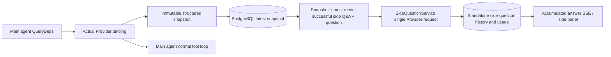

# ARTEX `/btw`

Ordinary chat, a task's MainAgent, and the current task's own Worker all support standalone side-channel questions. Type `/btw question` in the main input box to submit; an empty `/btw` or the "Side question" button opens the history. The desktop uses a resizable side panel, and mobile uses a Drawer.

A side-channel answer is generated from a snapshot of the agent context captured at submission time, and supports streaming display, follow-ups, stop, and clear. Closing the panel, refreshing the page, or dropping SSE does not cancel the model request. Stop only affects the current side question; Clear cancels the side question and deletes the side-question history, while preserving the main context snapshot.

## Implementation boundaries

It reuses Go, norma v0.3.7, Next.js, and the existing Markdown / ResizablePanel / Drawer / AlertDialog components; it does not modify the norma source or add dependencies for the side channel. The Planner, Workers inherited from other tasks, and tool-type subtask upgrades are out of scope this time.

- `capture.go` only marks a main-loop request in `Options.Deps.CallModel / CallModelSync`. The Provider decorator sits inside the concrete model, after the routing pool's outer selection, so it records the model actually chosen; compaction and summary requests do not overwrite the snapshot.
- The snapshot is published at request start, on a complete model reply, and at the run's terminal state. A half-finished, in-progress reply is not published; tool calls are kept paired via norma's `MessagesForAPI`, and a tool result enters the snapshot on the next main-model request or at the run's terminal state. A stream abort preserves the last valid boundary.
- The snapshot preserves structured messages, the system prompt, tool definitions, and generation parameters via a JSON deep copy. Model inference holds neither the snapshot lock nor a database transaction.
- `SideQuestionService` calls the concrete Provider; when necessary it first generates a side-channel summary, and the final answer is only allowed to be reduced and retried once, when the context first exceeds the limit and no text/tool call has yet been emitted. It does not create an agent session, does not hook into the tool executor, the main transcript, the activity feed, or the task graph, and does not go through the task's model-switching chain. The answer retains tool definitions for compatibility with the existing structured tool context; summary requests provide no tools. A newly returned tool call has no execution path.
- One running request per parent session, at most four per service process, with a 120-second timeout each. The side channel uses a standalone cancellation context under the service lifecycle.
- A side-channel request retains a reference to the model configuration and a non-sensitive identity summary; credentials are obtained from the existing configuration at request time. If the configuration is deleted, or identity fields such as model, protocol, or address change, it requires running the main agent first to update the snapshot. Tests do not change the product's default model.

## Persistence and recovery

`db/schema.sql` automatically creates `side_question_sessions` and `side_question_requests`. The former stores the parent resource, the latest snapshot, the run number, the version, and the clear version; the latter stores the question, the accumulated answer, status, model, snapshot time, usage, event ordinal, and pagination ordinal.

The parent-session key uses the conversation ID, or the task ID + exploration ID + intent ID. Workers do not use reusable execution-slot naming.

Snapshots are merged and written per parent session, flushed every 250 ms, and the database compares `(run_id, version)` to prevent an old version from overwriting. The selected snapshot is saved again before a side question is submitted. After a successful save, the large in-memory snapshot is released; on failure, the pending version is kept. The answer's accumulated content is written at most every 250 ms as streaming events arrive, and the terminal state is saved immediately with bounded retries on a database error.

On service start, leftover `running` requests are marked `interrupted`, keeping the already-persisted partial answer and usage, and requests are not auto-replayed. The most recently successfully saved context can be used directly for the next question. When an old session has no snapshot, it requires running the main agent first and does not reconstruct the context from the UI activity record.

A clear operation increments the clear version and deletes the requests; a conditional update blocks a late callback from writing back. Physical deletion of the parent resource relies on foreign-key cascades; a Worker's logical deletion removes the side-channel data in the same transaction and rejects subsequent late snapshots. Task archiving first blocks new requests, waits for the main flow to stop, then cancels and waits for the side channel to persist; the archive format is v3, while remaining compatible with v1/v2 that have no side-channel tables.

The history is kept in full and returns at most 20 items per page by an ordinal cursor. A model request replays the verbatim text of at most the 20 most recent successful Q&As, while also limiting the replay amount by token budget; older Q&As maintain a separate rolling summary. When the main context exceeds the budget, only the old part of the side-channel copy is summarized, preserving recent structured tool calls and results. The summary, preparation progress, and usage are all subject to the side channel's concurrency, cancellation, and 120-second timeout limits. See [Context budget and open-source references](CONTEXT_BUDGET.md) for details.

## HTTP contract

The following paths act as `{parent}`, reusing the existing authentication and resource checks:

- `/api/conversations/{id}`
- `/api/tasks/{id}/chat`
- `/api/tasks/{id}/intents/{iid}`

| Request | Response and behavior |
| --- | --- |
| `GET {parent}/side-questions?before={ordinal}` | `items` ordered newest-to-oldest, a standalone `current` run status, `snapshot` metadata, `next_cursor`; a cursor of 0 means the latest page / no next page |
| `POST {parent}/side-questions` | JSON `{ "question": "…", "client_request_id": "UUID" }`; a new request returns 202 and the request object; the same ID and question returns the existing object with 200 |
| `DELETE {parent}/side-questions` | cancel and clear the current parent session's side-channel Q&A |
| `GET /api/side-questions/{requestID}/events` | `snapshot` SSE events, with `id` as an increasing ordinal and `data` as the complete accumulated request object; sends `cleared` when cleared |
| `POST /api/side-questions/{requestID}/cancel` | explicit cancel; the terminal state can be read from history or SSE |

The question cap is 4000 characters. No snapshot, a model-configuration change, a busy parent session, or an idempotency-ID conflict returns 409; the global concurrency cap returns 429. Every SSE connection sends the accumulated state first and does not rely on text fragments the client received earlier. The frontend merges by request ID + ordinal, and discards stale callbacks when switching parent sessions or clearing.

## Validation and references

See [VALIDATION.md](VALIDATION.md) for automated checks, real model usage, and known limitations.

For the standalone request, see [Grok CLI side-question.ts (pinned commit)](https://github.com/superagent-ai/grok-cli/blob/fb97af83f06dca873281d60168430f06c8de6324/src/utils/side-question.ts); for run isolation, see [OpenCode (pinned commit)](https://github.com/anomalyco/opencode/tree/b3f1a96c6dd7adeb28b36dd11add1998fc84d67b). ARTEX's context uses norma's structured messages and does not take the approach of concatenating text from frontend logs.
