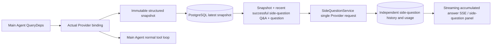

# ARTEX `/btw`

Regular chat, the task MainAgent, and the Worker for the current task all support independent side-question asking. Type `/btw question` in the main input box to submit; an empty `/btw` or the "Side question" button opens history. Desktop uses a resizable sidebar, mobile uses a Drawer.

Side-question answers are generated from a snapshot of the Agent context taken at submission time, and support streaming display, follow-up questions, stopping, and clearing. Closing the panel, refreshing the page, or disconnecting SSE does not cancel the model request. Stop only affects the current side question; clear cancels the side question and deletes side-question history, while keeping the main context snapshot.

## Implementation boundaries

Reuses Go, norma v0.3.7, Next.js, and the existing Markdown / ResizablePanel / Drawer / AlertDialog components; no modifications to norma source code and no dependencies added for side-question. Planner, Workers inherited from other tasks, and tool-style subtask escalation are out of scope.

- `capture.go` only flags main-loop requests at `Options.Deps.CallModel / CallModelSync`. The Provider decorator is located inside the concrete model, after the outer routing-pool selection, so it records the actually selected model; compression and summarization requests do not overwrite the snapshot.
- Snapshots are published at request start, on complete model reply, and on run terminal state. Partial in-progress replies are not published; tool calls are paired via norma's `MessagesForAPI`, and tool results enter the snapshot on the next main-model request or run terminal state. Streaming abort keeps the previous valid boundary.
- Snapshots preserve structured messages, system prompt, tool definitions, and generation parameters via JSON deep copy. Model inference does not hold snapshot locks or database transactions.
- `SideQuestionService` calls the concrete Provider; if needed, it first generates a side-question summary; the final answer only allows one reduced retry when the context first exceeds the limit and no text/tool calls have yet been output. No agent session is created, no tool executor, main transcript, activity stream, or task graph is wired in, and it does not go through the task model switch chain. The answer retains tool definitions for compatibility with existing structured tool context; summary requests do not provide tools. Newly returned tool calls have no execution path.
- One running request per parent session, up to four per service process, single timeout 120 seconds. Side questions use an independent cancellation context under the service lifecycle.
- Side-question requests retain a reference to the model configuration and a non-sensitive identity digest; credentials are obtained from the existing configuration at request time. If the configuration is deleted, or identity fields such as model, protocol, or address change, the main Agent must be run first to update the snapshot. Tests do not change the product default model.

## Persistence and recovery

`db/schema.sql` automatically creates `side_question_sessions` and `side_question_requests`. The former stores the parent resource, latest snapshot, run number, version, and cleanup version; the latter stores the question, accumulated answer, status, model, snapshot time, usage, event ordinal, and paging ordinal.

The parent session key uses the conversation ID, or task ID + exploration ID + intent ID. Workers do not use reusable execution-slot naming.

Snapshots are merged and written per parent session, flushed every 250 ms, and the database compares `(run_id, version)` to prevent older versions from overwriting. The selected snapshot is saved again just before side-question submission. On successful save, large snapshots in memory are released; on failure, the pending-to-write version is kept. Accumulated answer content is written at most every 250 ms as streaming events arrive, and saved immediately on terminal state with limited retry on database error.

On service startup, leftover `running` requests are marked `interrupted`, keeping the already-persisted partial answer and usage, without auto-replaying the request. The most recently successfully saved context can be used directly for the next question. For old sessions, if no snapshot exists, the main Agent must be run first; context is not rebuilt from UI activity records.

The clear operation increments the cleanup version and deletes requests; conditional updates prevent late callbacks from writing back. Physical parent resource deletion relies on foreign-key cascade; Worker soft deletion removes side-question data in the same transaction and rejects subsequent late snapshots. Task archiving first blocks new requests, waits for the main flow to stop, cancels and waits for side-question data to persist; the archive format is v3, while still compatible with v1/v2 that lack the side-question table.

History is fully saved, returned at most 20 per page using an ordinal cursor. The model request replays at most the last 20 successful Q&A pairs verbatim, while limiting replay volume by token budget; older Q&A maintains an independent rolling summary. When the main context exceeds budget, only the old part of the side-question copy is summarized, preserving recent structured tool calls and results. Summary, preparation progress, and usage are all included in the side-question concurrency, cancel, and 120-second timeout limits. See [Context budget and open-source references](CONTEXT_BUDGET.md) for details.

## HTTP contract

The following paths serve as `{parent}`, reusing the existing authentication and resource validation:

- `/api/conversations/{id}`
- `/api/tasks/{id}/chat`
- `/api/tasks/{id}/intents/{iid}`

| Request | Response and behavior |
| --- | --- |
| `GET {parent}/side-questions?before={ordinal}` | `items` sorted newest to oldest, independent `current` running state, `snapshot` metadata, `next_cursor`; cursor 0 means latest page / no next page |
| `POST {parent}/side-questions` | JSON `{ "question": "…", "client_request_id": "UUID" }`; new request returns 202 with the request object; same ID and question returns the existing object with 200 |
| `DELETE {parent}/side-questions` | Cancels and clears side-question Q&A for the current parent session |
| `GET /api/side-questions/{requestID}/events` | `snapshot` SSE events, `id` is an incrementing ordinal, `data` is the full accumulated request object; sends `cleared` on clear |
| `POST /api/side-questions/{requestID}/cancel` | Explicit cancel; terminal state can be read from history or SSE |

Question limit is 4000 characters. Returns 409 for no snapshot, model configuration changes, busy parent session, or idempotent ID conflict; returns 429 for global concurrency limit. Each SSE connection sends accumulated state first, not relying on text fragments previously received by the client. The frontend merges by request ID + ordinal, and discards old callbacks when switching parent sessions or clearing.

## Validation and references

See [VALIDATION.md](VALIDATION.md) for automated checks, actual model usage, and known limitations.

Independent request reference [Grok CLI side-question.ts (fixed commit)](https://github.com/superagent-ai/grok-cli/blob/fb97af83f06dca873281d60168430f06c8de6324/src/utils/side-question.ts), runtime isolation reference [OpenCode (fixed commit)](https://github.com/anomalyco/opencode/tree/b3f1a96c6dd7adeb28b36dd11add1998fc84d67b). ARTEX's context uses norma's structured messages, not the approach of concatenating text from frontend logs.