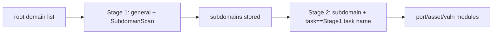

---

## name: scopesentry-mcp
description: Manage a security scanning platform (projects, tasks, templates, assets, nodes) via the ScopeSentry MCP. Use when the user mentions ScopeSentry, MCP, API Key, scan tasks, or asset queries.

# ScopeSentry MCP user guide

For users with a **deployed ScopeSentry instance**. Connect to the platform via Cursor (or another MCP client); no local source code required.

## 1. Prerequisites

### 1.1 Confirm the service is reachable

- Default web interface: `http://<host>`
- MCP endpoint: `http://<host>/mcp` (if there is a reverse proxy or frontend proxy in front, use the actual `/mcp` address)

### 1.2 Create an API Key

1. Log in to the ScopeSentry web interface in a browser
2. Go to the **API Key** management page and create a key (or create one via an admin-provided endpoint)
3. Save the returned `ssk_...` string (**shown only once**)

### 1.3 Configure Cursor MCP

Cursor → Settings → MCP → add a server:

```json
{
  "mcpServers": {
    "scopesentry": {
      "url": "http://<your-host>:8082/mcp",
      "headers": {
        "X-API-Key": "ssk_your-key"
      }
    }
  }
}
```

You can also use: `Authorization: Bearer ssk_your-key`

After configuring, restart the MCP or reload Cursor, and confirm that tools such as `list_projects` and `list_assets` appear in the tool list.

---

## 2. Tools at a glance


| Tool                     | Purpose                |
| ---------------------- | ----------------- |
| `list_projects`        | project tree grouped by tag (incl. project ID) |
| `list_projects_data`   | paginated project list, searchable by name     |
| `get_project`          | project details              |
| `create_project`       | create a project              |
| `list_tasks`           | scan task list            |
| `get_task`             | task details              |
| `list_scan_templates`  | scan template list            |
| `get_scan_template`    | template details              |
| `list_plugin_modules`  | scan pipeline module names          |
| `list_plugins`         | available plugins (incl. hash, default params) |
| `create_scan_template` | create a scan template            |
| `create_scan_task`     | create a scan task            |
| `list_assets`          | query assets of all kinds (paginated list)       |
| `count_assets`         | count assets (`/api/assets/common/total`) |
| `get_asset_detail`     | asset or vulnerability details           |
| `add_asset_tag`        | add a tag to an asset           |
| `list_nodes`           | scan node list            |


Each tool's parameters are governed by the MCP tool description (schema); `list_assets` / `count_assets` share the same search and filter syntax — before querying assets you can first read the `list_assets` description.

When you need to know "how many in total", use `count_assets` (the web pagination-total endpoint); do not repeatedly page through `list_assets` just to count the total.

---

## 3. Common workflows

### 3.1 Query assets by project

When the user or context **already has a project condition**, prefer adding `filter.project` to narrow the scope and avoid slow responses from too much cross-project data. If there is no explicit project, a project filter is not mandatory.

1. `list_projects` or `list_projects_data` to get the target project's **ObjectID** (`id` / `children[].value`)
2. `list_assets` with `filter.project` (**must be the ID, not the project's Chinese name**)

```json
{
  "asset_type": "asset",
  "pageIndex": 1,
  "pageSize": 20,
  "search": "domain=^example.com",
  "filter": {
    "project": ["<project ObjectID>"]
  }
}
```

### 3.2 Create a scan task

1. `list_nodes` to get online node names
2. `list_scan_templates` or `create_scan_template` to get the template **ObjectID**
3. `create_scan_task`: `name` and `node` are required, `template` takes the template ID (not the template name)

**Target source `targetSource` (same as the web UI):**

| targetSource | Description | Required parameters |
| --- | --- | --- |
| `general` | enter targets directly | `target` |
| `project` | read targets from a project | `project` (array of project ObjectIDs) |
| `asset` | search the web asset store | `search`; optional `project`, `filter`, `targetNumber` |
| `RootDomain` | search the root-domain store | `search`; optional `project`, `filter`, `targetNumber` |
| `subdomain` | search the subdomain store | `search`; optional `project`, `filter`, `targetNumber` |
| `UrlScan` | search URL-scan results | `search`; optional `project`, `filter`, `targetNumber` |
| `*Source` (e.g. `subdomainSource`) | create from "selected/searched" on the asset page | with `targetTp=search` use `search`; with `targetTp=select` use `targetIds` |

**Example — scan root domains directly:**

```json
{
  "name": "example-subdomain-collection",
  "node": ["node-1"],
  "template": "<template ObjectID>",
  "targetSource": "general",
  "target": "example.com\nfoo.com",
  "project": ["<project ObjectID>"]
}
```

**Example — continue scanning from the subdomain store (filtered by the previous task name):**

```json
{
  "name": "example-ports-and-vulns",
  "node": ["node-1"],
  "template": "<follow-up-module template ObjectID>",
  "targetSource": "subdomain",
  "search": "task==\"example-subdomain-collection\"",
  "project": ["<project ObjectID>"]
}
```

### 3.3 Full information gathering on a root domain (two-stage recommended)

When the input is a **root domain** and you want **full information gathering**, run two separate scans rather than the whole pipeline at once.

**Reason:** Distributed tasks are dispatched per **individual target**. When a root domain is the target, the subdomains discovered on whichever node that root domain lands on also continue running the follow-up modules on that same node, which easily causes load imbalance, slowness, and errors.

**Best practice:**

1. **Stage 1 — subdomain collection only**
   - `targetSource`: `general`
   - `target`: all root domains (multiple lines)
   - template: enable only `SubdomainScan`, `SubdomainSecurity` (subdomain scanning + subdomain takeover)
   - use `get_task` to wait for the task to finish

2. **Stage 2 — follow-up modules**
   - `targetSource`: `subdomain`
   - `search`: `task=="<Stage 1 task name>"` (exact match on the task name)
   - optional `project` to narrow the scope
   - template: port scanning, asset mapping, vulnerability scanning, etc. (SubdomainScan can be omitted)
   - subdomains are dispatched to the nodes as independent targets, giving higher parallel efficiency

You can also filter by task name on the web interface's "Subdomains" asset page and use "Create task from subdomains", with the same effect.



### 3.4 Create a scan template

1. `list_plugin_modules` → list of module names
2. `list_plugins` (filterable by `module`) → each plugin's `hash` and default `parameter`
3. `create_scan_template`: use `modules` to specify "module → array of plugin hashes"

---

## 4. Asset queries (`list_assets` / `count_assets`)

`count_assets` uses the same `asset_type`, `search`, and `filter` as `list_assets`, and returns `{ "total": N }`, corresponding to the web endpoint `/api/assets/common/total`.

```json
{
  "asset_type": "subdomain",
  "search": "task==\"some task name\"",
  "filter": {"project": ["<project ObjectID>"]}
}
```

**Performance tips (apply to both `list_assets` / `count_assets`):** when there is a project condition, prefer `filter.project` to narrow the scope; in `search`, use `==` exact-equality or `^` prefix matching on indexed fields where possible (see [4.3](#43-search-expressions)) to avoid broad `=` fuzzy queries slowing the response. Without project context, a project filter is not mandatory.

For the types that support `filter.project`, see the table in [4.4](#44-filter-exact-filtering).

### 4.1 Asset types `asset_type`

`asset`, `RootDomain`, `subdomain`, `app`, `mp`, `UrlScan`, `SensitiveResult`, `DirScanResult`, `crawler`, `vulnerability`, `PageMonitoring`, `IPAsset`, `SubdomainTakerResult`

Alias examples: `web`→asset, `vuln`→vulnerability, `ip`→IPAsset, `url`→UrlScan

### 4.2 Parameters


| Parameter                       | Description                                      |
| ------------------------ | --------------------------------------- |
| `pageIndex` / `pageSize` | pagination, default 1 / 20                            |
| `search`                 | search expression (see next section)                              |
| `filter`                 | exact-filter JSON (see next section)                          |
| `sort`                   | only UrlScan, DirScanResult support sorting by `length` |
| `sid`                    | only SensitiveResult: sensitive-rule name                |


`search` and `filter` **can be used together**.

### 4.3 search expressions

A custom DSL (**not SQL**):


| Operator  | Meaning   | Index | Example                          |
| ---- | ---- | ---- | --------------------------- |
| `=`  | fuzzy match (regex) | no index | `domain=example`            |
| `==` | exact match (equals) | **uses index** | `port==443`                 |
| `!=` | exclude   | — | `port!="80"`                |
| `&&` | AND    | — | `domain==example.com && port==443` |
| `||` | OR    | — | `title=admin || body=login` |


**Indexes and operators:** fields such as `domain`, `ip`, `port`, `title` are indexed, but only **`==` exact-equality** or **prefix matching where the value starts with `^`** (e.g. `domain=^example.com`) can use the index; **`=` is converted to a regex fuzzy match and cannot use the index**, and tends to be slow on large data.

**search fields common to all types:** `tag`, `task` (task name), `rootDomain`

**`project` cannot be written in `search`** (it is invalid, or errors when combined with `&&`). To filter by project use `filter.project`.

**Common search fields per type:**


| asset_type           | Fields                                                                                  |
| -------------------- | ----------------------------------------------------------------------------------- |
| asset                | domain, ip, port, service, app, title, statuscode, icon, banner, type, body, header |
| RootDomain           | domain, icp, company                                                                |
| subdomain            | domain, ip, type, value                                                             |
| app                  | name, icp, company, category, description, url, apk                                 |
| mp                   | name, icp, company, category, description, url                                      |
| UrlScan              | url, input, source, resultId, type                                                  |
| SensitiveResult      | url, sname, body, info, md5                                                         |
| DirScanResult        | url, statuscode, redirect, length                                                   |
| vulnerability        | url, vulname, matched, request, response, level                                     |
| crawler              | url, method, body, resultId                                                         |
| PageMonitoring       | url, hash, diff, response                                                           |
| IPAsset              | ip, domain, port, service, webServer, app                                           |
| SubdomainTakerResult | domain, value, type, response                                                       |


**search examples:**

- `domain==www.example.com && port==443` (exact, uses index)
- `domain=^example.com` (prefix match, uses index)
- `ip==192.168.1.1`
- `task=="some task name"`
- `level==high` (vulnerability)
- `statuscode==200` (DirScanResult)

When a fuzzy contains is needed, use `=`, e.g. `title=admin` (does not use the index; best combined with a project or other condition to narrow the scope).

### 4.4 filter (exact filtering)

A JSON object: multiple values under the same key are **OR**, different keys are **AND**.

**When there is a project condition, prefer `project`:** if the user or context has an explicit project and the asset_type supports `project`, include it to narrow the scope; it is not mandatory without project info.


| filter key   | Meaning       | Value notes                                                     |
| ------------ | -------- | -------------------------------------------------------- |
| `project`    | owning project     | **ObjectID**, obtained via `list_projects` / `list_projects_data` |
| `task`       | source task     | **task name**, from `list_tasks`' `name`                         |
| `port`       | port       | e.g. `"443"`                                                |
| `service`    | service/protocol    | e.g. `"https"`                                              |
| `app`        | app fingerprint     | e.g. `"Nginx"`                                              |
| `icon`       | icon hash  |                                                          |
| `statuscode` | HTTP status code | mainly for asset                                               |
| `status`     | status       | UrlScan/DirScan HTTP code; vuln/sensitive-info handling status                       |
| `level`      | vulnerability level     | critical / high / medium / low / info                    |
| `type`       | type       | e.g. subdomain record type A, CNAME                                         |
| `color`      | sensitive-rule color   | SensitiveResult                                          |
| `sname`      | sensitive-rule name    | SensitiveResult                                          |
| `tags`       | tags       |                                                          |


**Available filter keys per type:**


| asset_type                            | filter key                                                      |
| ------------------------------------- | --------------------------------------------------------------- |
| asset                                 | project, port, service, app, icon, statuscode, type, task, tags |
| RootDomain                            | project, tags                                                   |
| subdomain                             | project, type, task, tags                                       |
| app / mp                              | project, tags                                                   |
| UrlScan                               | status, tags                                                    |
| DirScanResult                         | status, tags                                                    |
| SensitiveResult                       | status, color, sname, tags                                      |
| crawler                               | project, task, tags                                             |
| vulnerability                         | project, level, status, task, tags                              |
| PageMonitoring / SubdomainTakerResult | tags                                                            |
| IPAsset                               | project, port, service, app                                     |


**filter example:**

```json
{"project": ["<project ObjectID>"], "port": ["443"]}
```

**Combined-query example:**

```json
{
  "asset_type": "asset",
  "search": "domain=^baidu && port==443",
  "filter": {"project": ["<project ObjectID>"]},
  "pageIndex": 1,
  "pageSize": 10
}
```

**Notes:**

- When there is a project condition, prefer including `filter.project` (where supported); without project context it is not mandatory
- Do not put the project's display name in `filter.project`
- Use `==` for known values and `^` for prefixes; avoid overusing `=` fuzzy matching on large tables
- For UrlScan HTTP status use `filter.status`; for DirScanResult you can use `statuscode==200` in search
- For SensitiveResult by rule name: use `sname=rule-name` in `search`, or `filter.sname`

### 4.5 Sorting with sort

Only **UrlScan** and **DirScanResult** support it:

```json
{"length": "ascending"}
```

Other types ignore `sort` and sort by time by default.

---

## 5. Scan template module names

`TargetHandler`, `SubdomainScan`, `SubdomainSecurity`, `PortScanPreparation`, `PortScan`, `PortFingerprint`, `AssetMapping`, `AssetHandle`, `URLScan`, `WebCrawler`, `URLSecurity`, `DirScan`, `VulnerabilityScan`, `PassiveScan`

---

## 6. Troubleshooting


| Symptom        | Handling                                                 |
| --------- | -------------------------------------------------- |
| MCP has no tools   | check the URL, API Key, and whether ScopeSentry is running                    |
| 401 / 403 | re-create or replace the API Key                                    |
| assets not found     | confirm `filter.project` is an ObjectID; do not put project in search |
| template/task creation fails | `template` must be a template ObjectID; `node` takes online node names            |
| queries very slow/stuck   | with a project, add `filter.project`; in search use `==` or `^` prefix on indexed fields, use `=` sparingly; reduce `pageSize` |


---

