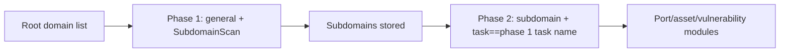

# ScopeSentry MCP Usage Guide

For users with a **deployed ScopeSentry instance**. Connect the platform through Cursor (or another MCP client) without needing local source code.

## 1. Preparation

### 1.1 Verify service reachability

- Default Web UI: `http://<host>`
- MCP endpoint: `http://<host>/mcp` (if a reverse proxy or front-end proxy is in front, use the actual `/mcp` address)

### 1.2 Create an API Key

1. Sign in to the ScopeSentry Web UI in your browser.
2. Go to the **API Key** management page and create a key (or have an administrator create one through the provided interface).
3. Save the returned `ssk_...` string (**displayed only once**).

### 1.3 Configure Cursor MCP

Cursor → Settings → MCP → add server:

```json
{
  "mcpServers": {
    "scopesentry": {
      "url": "http://<your-host>:8082/mcp",
      "headers": {
        "X-API-Key": "ssk_your-key"
      }
    }
  }
}
```

You may also use: `Authorization: Bearer ssk_your-key`

After configuration, restart the MCP or reload Cursor and confirm that tools such as `list_projects` and `list_assets` appear in the tool list.

---

## 2. Tool overview


| Tool | Purpose |
| --- | --- |
| `list_projects` | Project tree grouped by tags (includes project IDs) |
| `list_projects_data` | Paginated project list, searchable by name |
| `get_project` | Project details |
| `create_project` | Create a new project |
| `list_tasks` | Scan task list |
| `get_task` | Task details |
| `list_scan_templates` | Scan template list |
| `get_scan_template` | Template details |
| `list_plugin_modules` | Scan pipeline module names |
| `list_plugins` | Available plugins (with hash and default parameters) |
| `create_scan_template` | Create a scan template |
| `create_scan_task` | Create a scan task |
| `list_assets` | Query various assets (paginated list) |
| `count_assets` | Count assets (`/api/assets/common/total`) |
| `get_asset_detail` | Asset or vulnerability details |
| `add_asset_tag` | Add a tag to an asset |
| `list_nodes` | Scan node list |


Tool parameters follow the MCP tool description (schema); `list_assets` and `count_assets` share the same `search` and `filter` syntax, so review the `list_assets` description before querying assets.

When you need to know the "total count", use `count_assets` (corresponding to the Web pagination total endpoint) instead of paging through `list_assets` repeatedly.

---

## 3. Common workflows

### 3.1 Query assets by project

When the user or context **already has a project condition**, prefer passing `filter.project` to narrow the scope and avoid slow responses caused by excessive cross-project data. If no project is specified, the project filter is not required.

1. Use `list_projects` or `list_projects_data` to obtain the target project's **ObjectID** (`id` / `children[].value`).
2. Pass the `filter.project` to `list_assets` (**must be an ID, not the project's display name**).

```json
{
  "asset_type": "asset",
  "pageIndex": 1,
  "pageSize": 20,
  "search": "domain=^example.com",
  "filter": {
    "project": ["<project ObjectID>"]
  }
}
```

### 3.2 Create a scan task

1. Use `list_nodes` to obtain the names of online nodes.
2. Use `list_scan_templates` or `create_scan_template` to obtain the template's **ObjectID**.
3. `create_scan_task`: `name` and `node` are required; `template` takes the template ID (not the template name).

**Target source `targetSource` (matches the Web UI):**


| targetSource | Description | Required parameters |
| --- | --- | --- |
| `general` | Enter targets directly | `target` |
| `project` | Read targets from a project | `project` (array of project ObjectIDs) |
| `asset` | Search from the Web asset library | `search`; optional `project`, `filter`, `targetNumber` |
| `RootDomain` | Search from the root domain library | `search`; optional `project`, `filter`, `targetNumber` |
| `subdomain` | Search from the subdomain library | `search`; optional `project`, `filter`, `targetNumber` |
| `UrlScan` | Search from URL scan results | `search`; optional `project`, `filter`, `targetNumber` |
| `*Source` (e.g. `subdomainSource`) | Created from "selected/searched" on the asset page | Use `search` when `targetTp=search`; use `targetIds` when `targetTp=select` |

**Example — scan a root domain directly:**

```json
{
  "name": "example-subdomain-collection",
  "node": ["node-1"],
  "template": "<template ObjectID>",
  "targetSource": "general",
  "target": "example.com\nfoo.com",
  "project": ["<project ObjectID>"]
}
```

**Example — continue scanning from the subdomain library (filter by previous task name):**

```json
{
  "name": "example-ports-and-vulnerabilities",
  "node": ["node-1"],
  "template": "<follow-up-module template ObjectID>",
  "targetSource": "subdomain",
  "search": "task==\"example-subdomain-collection\"",
  "project": ["<project ObjectID>"]
}
```

### 3.3 Full root domain information gathering (recommended two-phase approach)

When the input is a **root domain** and you need a **complete information gathering**, run two scans instead of a single full pipeline.

**Reason:** Distributed tasks are dispatched per **single target**. When a root domain is the target, the node that picks up that root domain will also run follow-up modules on the subdomains it discovers on the same node. This easily causes load imbalance, slow performance, and errors.

**Best practice:**

1. **Phase 1 — subdomain collection only**
   - `targetSource`: `general`
   - `target`: all root domains (one per line)
   - Template: enable only `SubdomainScan` and `SubdomainSecurity` (subdomain scan + subdomain takeover)
   - Wait for the task to complete with `get_task`.

2. **Phase 2 — follow-up modules**
   - `targetSource`: `subdomain`
   - `search`: `task=="<phase 1 task name>"` (exact task name match)
   - Optional `project` to narrow the scope
   - Template: port scan, asset mapping, vulnerability scan, etc. (SubdomainScan may be excluded)
   - Subdomains are dispatched to nodes as independent targets, yielding higher parallelism.

You can also filter by task name on the "Subdomain" asset page in the Web UI and use "Create task from subdomain" for the same effect.



### 3.4 Create a scan template

1. `list_plugin_modules` → module name list
2. `list_plugins` (optionally filtered by `module`) → each plugin's `hash` and default `parameter`
3. `create_scan_template`: use `modules` to specify "module → plugin hash array"

---

## 4. Asset queries (`list_assets` / `count_assets`)

`count_assets` and `list_assets` share the same `asset_type`, `search`, and `filter`, and return `{ "total": N }`, corresponding to the Web endpoint `/api/assets/common/total`.

```json
{
  "asset_type": "subdomain",
  "search": "task==\"some-task-name\"",
  "filter": {"project": ["<project ObjectID>"]}
}
```

**Performance tips (apply to both `list_assets` and `count_assets`):** When a project condition exists, prefer `filter.project` to narrow the scope; for indexed fields, use `==` for exact match or `^` for prefix match in `search` (see [4.3](#43-search-expression)) to avoid slow responses from large-scale `=` fuzzy queries. Without project context, the project filter is not required.

See the table in [4.4](#44-filter-exact-filtering) for types that support `filter.project`.

### 4.1 Asset types `asset_type`

`asset`, `RootDomain`, `subdomain`, `app`, `mp`, `UrlScan`, `SensitiveResult`, `DirScanResult`, `crawler`, `vulnerability`, `PageMonitoring`, `IPAsset`, `SubdomainTakerResult`

Alias examples: `web`→asset, `vuln`→vulnerability, `ip`→IPAsset, `url`→UrlScan

### 4.2 Parameter reference


| Parameter | Description |
| --- | --- |
| `pageIndex` / `pageSize` | Pagination, default 1 / 20 |
| `search` | Search expression (see next section) |
| `filter` | Exact-filter JSON (see next section) |
| `sort` | Only UrlScan and DirScanResult support sorting by `length` |
| `sid` | SensitiveResult only: sensitive rule name |


`search` and `filter` **can be used together**.

### 4.3 `search` expression

Custom DSL (**not SQL**):


| Operator | Meaning | Index | Example |
| --- | --- | --- | --- |
| `=` | Fuzzy match (regex) | not indexed | `domain=example` |
| `==` | Exact match (equality) | **indexed** | `port==443` |
| `!=` | Exclude | — | `port!="80"` |
| `&&` | AND | — | `domain==example.com && port==443` |
| `||` | OR | — | `title=admin || body=login` |


**Indexing and operators:** Fields such as `domain`, `ip`, `port`, and `title` are indexed, but only **`==` exact match** or **prefix match with `^`** (e.g. `domain=^example.com`) can use the index. **`=` is converted to a regex fuzzy match and cannot use the index**, so it becomes slow on large datasets.

**`search` fields common to all types:** `tag`, `task` (task name), `rootDomain`

**`project` cannot be used in `search`** (it is invalid or returns an error when combined with `&&`). Filter by project with `filter.project`.

**Common `search` fields per type:**


| asset_type | Fields |
| --- | --- |
| asset | domain, ip, port, service, app, title, statuscode, icon, banner, type, body, header |
| RootDomain | domain, icp, company |
| subdomain | domain, ip, type, value |
| app | name, icp, company, category, description, url, apk |
| mp | name, icp, company, category, description, url |
| UrlScan | url, input, source, resultId, type |
| SensitiveResult | url, sname, body, info, md5 |
| DirScanResult | url, statuscode, redirect, length |
| vulnerability | url, vulname, matched, request, response, level |
| crawler | url, method, body, resultId |
| PageMonitoring | url, hash, diff, response |
| IPAsset | ip, domain, port, service, webServer, app |
| SubdomainTakerResult | domain, value, type, response |


**`search` examples:**

- `domain==www.example.com && port==443` (exact match, indexed)
- `domain=^example.com` (prefix match, indexed)
- `ip==192.168.1.1`
- `task=="some-task-name"`
- `level==high` (vulnerability)
- `statuscode==200` (DirScanResult)

Use `=` only when you need fuzzy containment, e.g. `title=admin` (not indexed; combine with project or other conditions to narrow the scope).

### 4.4 `filter` exact filtering

JSON object: multiple values for the same key are combined with **OR**, different keys are combined with **AND**.

**Prefer `project` when a project condition is available:** If the user or context already specifies a project and the asset_type supports `project`, include it to narrow the scope. Without project information, the filter is not required.


| filter key | Meaning | Value notes |
| --- | --- | --- |
| `project` | Owning project | **ObjectID**, obtained via `list_projects` / `list_projects_data` |
| `task` | Source task | **Task name**, from the `name` field of `list_tasks` |
| `port` | Port | e.g. `"443"` |
| `service` | Service/protocol | e.g. `"https"` |
| `app` | Application fingerprint | e.g. `"Nginx"` |
| `icon` | Icon hash | |
| `statuscode` | HTTP status code | mainly for asset |
| `status` | Status | UrlScan/DirScan HTTP code; vulnerability/sensitive-info processing status |
| `level` | Vulnerability severity | critical / high / medium / low / info |
| `type` | Type | e.g. subdomain record types A, CNAME |
| `color` | Sensitive-rule color | SensitiveResult |
| `sname` | Sensitive-rule name | SensitiveResult |
| `tags` | Tags | |


**Available `filter` keys per type:**


| asset_type | filter key |
| --- | --- |
| asset | project, port, service, app, icon, statuscode, type, task, tags |
| RootDomain | project, tags |
| subdomain | project, type, task, tags |
| app / mp | project, tags |
| UrlScan | status, tags |
| DirScanResult | status, tags |
| SensitiveResult | status, color, sname, tags |
| crawler | project, task, tags |
| vulnerability | project, level, status, task, tags |
| PageMonitoring / SubdomainTakerResult | tags |
| IPAsset | project, port, service, app |


**`filter` example:**

```json
{"project": ["<project ObjectID>"], "port": ["443"]}
```

**Combined query example:**

```json
{
  "asset_type": "asset",
  "search": "domain=^baidu && port==443",
  "filter": {"project": ["<project ObjectID>"]},
  "pageIndex": 1,
  "pageSize": 10
}
```

**Notes:**

- Prefer `filter.project` when a project condition is available (when supported); without project context the filter is not required.
- Do not use the project display name in `filter.project`.
- Use `==` for known values and `^` for prefixes; avoid abusing `=` fuzzy match on large tables.
- UrlScan HTTP status uses `filter.status`; DirScanResult can use `statuscode==200` in `search`.
- For SensitiveResult by rule name: use `sname=rule-name` in `search`, or `filter.sname`.

### 4.5 Sorting `sort`

Only **UrlScan** and **DirScanResult** are supported:

```json
{"length": "ascending"}
```

Other types ignore `sort` and use the default time order.

---

## 5. Scan template module names

`TargetHandler`, `SubdomainScan`, `SubdomainSecurity`, `PortScanPreparation`, `PortScan`, `PortFingerprint`, `AssetMapping`, `AssetHandle`, `URLScan`, `WebCrawler`, `URLSecurity`, `DirScan`, `VulnerabilityScan`, `PassiveScan`

---

## 6. Troubleshooting


| Symptom | Resolution |
| --- | --- |
| No MCP tools | Check the URL, API Key, and that ScopeSentry is running |
| 401 / 403 | Recreate or replace the API Key |
| Assets not found | Confirm `filter.project` is an ObjectID; do not write `project` in `search` |
| Template/task creation failed | `template` must be a template ObjectID; `node` must be an online node name |
| Query slow/stuck | Add `filter.project` when a project is available; for indexed fields in `search` use `==` or `^` prefix instead of `=`; reduce `pageSize` |


---
